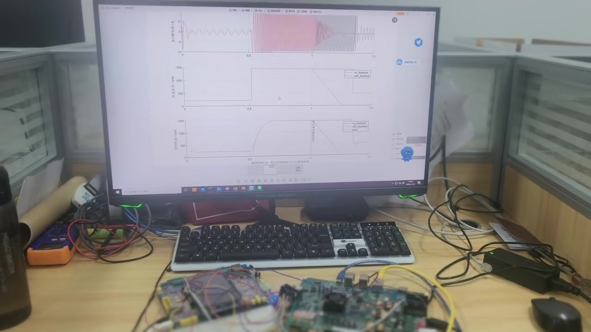
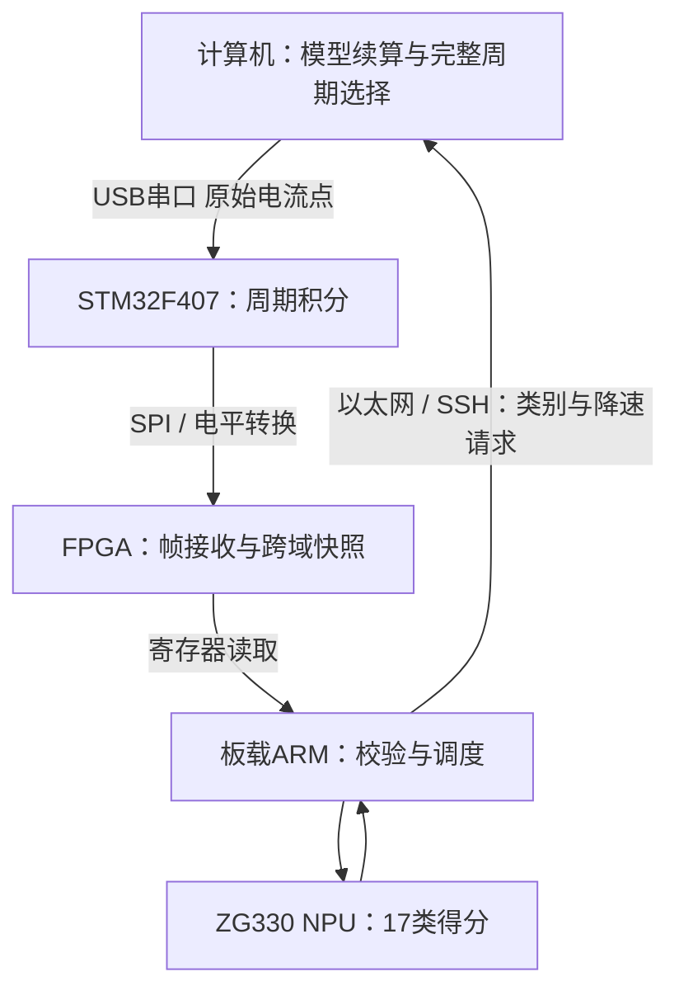

# 永磁同步电机智能诊断与健康控制

面向永磁同步电机 **B/C 电流采样偏移**，实现原始波形处理、17类实板诊断，以及诊断驱动的模型反馈验证。项目使用 STM32F407、悟净 Lite 开发板的 FPGA / ARM / ZG330 NPU 协同运行。



## 三项核心设计

| 设计 | 实现 |
| --- | --- |
| 诊断驱动的模型反馈闭环 | 连续3个有效周期确认同类异常后，更新未来转速参考；保留完整模型状态续算，后续新电流再次进入实板诊断。 |
| FPGA跨域快照一致性通信 | 实现SPI完整帧接收、132位状态与计数握手快照、ARM寄存器交接；通过有效写计数和报文校验检查重复写入、漏读与错误数据。 |
| 轻量NPU诊断与全链路追溯 | 两维周期均值输入609参数网络，编译部署到ZG330；按序号关联原始点、均值、分类结果及反馈动作。 |

## 系统分工



STM32计算周期特征，FPGA承担通信和状态快照，ARM调用厂商NPU运行库。本轮验证采用电机模型与真实计算板卡联合运行。

## 已保存的实验结果

| 项目 | 结果 |
| --- | --- |
| 预设类别 | 正常 + B/C各8个偏移档位，共17类 |
| 2026-11-03双组有效实板记录 | 不执行反馈57条，执行反馈23条，共80条 |
| 反馈动作后新完整诊断周期 | 11个 |
| 执行反馈组NPU推理及读取中位数 | 0.576 ms |
| 模型参考降至零 | 通过保存记录的预设验收条件 |
| 输入点、周期积分及反馈时序离线复核 | 通过，可使用下方命令复核 |

以上是指定实验的保存结果，不将软件测试计作新的上板实验。原始证据保存在 [evidence](evidence/)，实验范围和时间统计口径见 [复现说明](docs/reproduction.md)。

## 代码导航

| 目录 | 内容 |
| --- | --- |
| [motor_link_r4](motor_link_r4/) | R4 MATLAB准备、预检、运行、PC串口/SSH桥接与三周期确认策略 |
| [motor_raw_replay_v1](motor_raw_replay_v1/) | F4原始点解析/周期积分、Keil源工程和原始波形诊断界面 |
| [motor_demo_r2](motor_demo_r2/) | 分类展示、CRC验证和结果导出界面 |
| [fpga](fpga/) | 自编SPI接收与CDC快照模块、参考测试和引脚约束 |
| [board](board/) | 实际回收的板端服务、NPU调用及部署模型JSON/RAW |
| [models](models/) | 训练存档、已有ONNX和恢复的MATLAB训练/导出脚本 |
| [simulink](simulink/) | 已收到的SLX和数据字典 |
| [verification](verification/) | 保存实验的独立离线一致性复核程序 |

## 工程使用说明

模型输入输出、算子与NPU调用、板端部署、桌面操作、R4运行及故障排查，见 [llm_usage.md](llm_usage.md)。

## 无板卡的软件检查

```bash
python -m pip install -r requirements-dev.txt
python -m unittest discover -s motor_link_r4/tests -v
python verification/verify_saved_evidence.py
```

前一条执行7项软件测试，后一条独立复核保存的80条记录。它们不连接开发板、不替代硬件验收。

## 硬件运行入口

按照各目录的说明配置工具及板端运行库，先在MATLAB中初始化模型，再依次执行 `prepare_motor_link_r4`、`check_motor_link_r4`，启动PC桥接后执行 `run_motor_link_r4`。F4应运行支持 `RAW_HOST V1` 的原始点固件。完整依赖、版本对应和复现前核对事项见 [docs/reproduction.md](docs/reproduction.md)。

## 第三方依赖

公开目录包含自编程序、模型及验证资料。STM32 CMSIS文件保留原许可。厂商标注Confidential的FPGA顶层、NPU IP、EDIF、位流和工具运行库不在此仓库中分发，接入方式见 [fpga/README.md](fpga/README.md)。参见 [THIRD_PARTY.md](THIRD_PARTY.md)。
